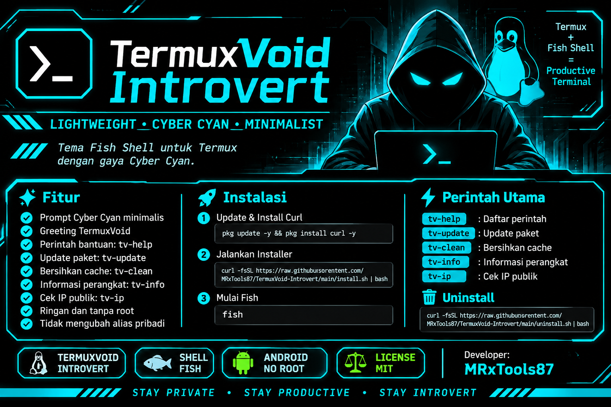

<p align="center">
  
</p>
# TermuxVoid Introvert

<p align="center">
  
  
  
  
</p>

<p align="center">
  Lightweight • Cyber Cyan • Minimalist
</p>

Tema Fish Shell untuk Termux dengan gaya Cyber Cyan.

#UNINSTALL
```bash
curl -fsSL https://raw.githubusercontent.com/MRxTools87/Introvert/main/uninstall.sh -o uninstall.sh; and bash uninstall.sh | bash
#Selamat Mencoba

## ✨ Fitur
- Prompt Cyber Cyan minimalis.
- Greeting TermuxVoid.
- Perintah bantuan `tv-help`.
- Update paket `tv-update`.
- Bersihkan cache `tv-clean`.
- Informasi perangkat `tv-info`.
- Cek IP publik `tv-ip`.
- Ringan dan tanpa root.
- Tidak mengubah alias pribadi.

## 📦 Instalasi

Jalankan di Termux:
Install
```bash
pkg update -y && pkg install curl -y
curl -fsSL https://raw.githubusercontent.com/MRxTools87/Introvert/main/install.sh | bash
